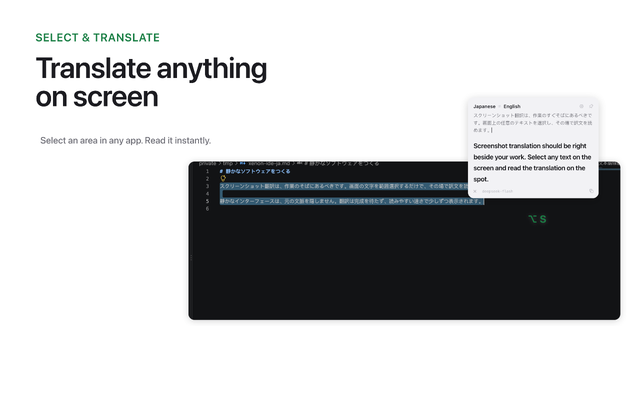
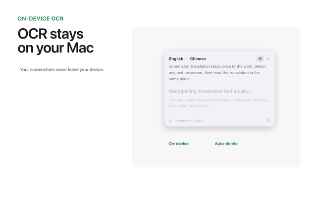
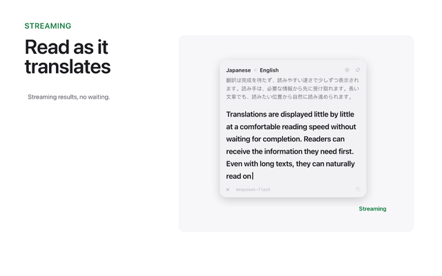
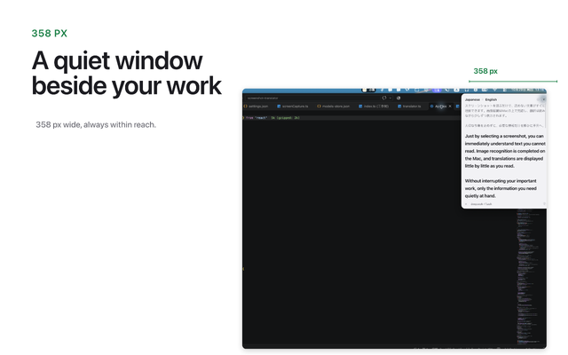
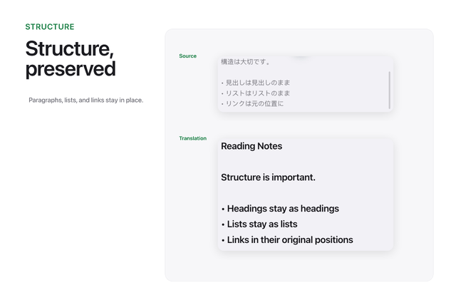
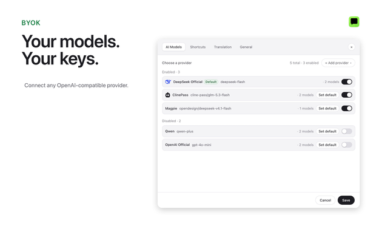
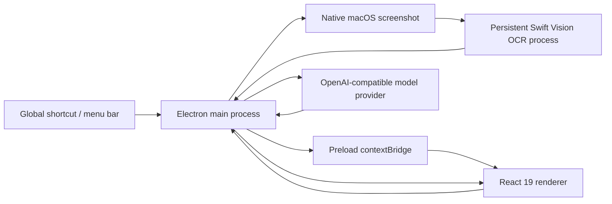

<div align="center">

# Xenon

**Screenshot translation that keeps the context intact**

On-device OCR, streaming translations, and multi-provider BYOK bring every word on your screen within reach.

[](https://www.apple.com/macos/)
[](https://react.dev/)
[](https://www.electronjs.org/)
[](https://github.com/GTTaaa/Xenon#supported-model-providers)
[](LICENSE)

</div>

<p align="center">
  
</p>

## Mac App Store Preview

The public Mac App Store listing currently uses the English screenshot set. These six screens cover translation, privacy, reading flow, staying out of the way, preserved structure, and model choice. Select any image to open the `2880 x 1800` original.

<table>
  <tr>
    <td width="50%" valign="top">
      <a href="export/mac/en/2880x1800/01-any-app.png">
        
      </a>
    </td>
    <td width="50%" valign="top">
      <a href="export/mac/en/2880x1800/02-on-device.png">
        
      </a>
    </td>
  </tr>
  <tr>
    <td width="50%" valign="top">
      <a href="export/mac/en/2880x1800/03-streaming.png">
        
      </a>
    </td>
    <td width="50%" valign="top">
      <a href="export/mac/en/2880x1800/04-quiet-window.png">
        
      </a>
    </td>
  </tr>
  <tr>
    <td width="50%" valign="top">
      <a href="export/mac/en/2880x1800/05-structure.png">
        
      </a>
    </td>
    <td width="50%" valign="top">
      <a href="export/mac/en/2880x1800/06-models.png">
        
      </a>
    </td>
  </tr>
</table>

## Why Xenon

Browser extensions only reach the web, while traditional translators usually ask you to copy text into another app. Xenon is built for the reading that actually happens on your desktop: PDFs, IDEs, terminals, design canvases, video frames, and every other surface a browser extension cannot touch.

Press `⌥ + S`, select a region of the screen, and Xenon keeps the image local for OCR. The recognized text then streams back as a translation in a narrow window that stays docked to the top-right corner. There is no account system, no bundled token quota, and no upload to a third-party OCR service.

### Core Capabilities

#### 01 · On-device OCR with macOS Swift Vision

- Screenshots are captured with the native macOS `screencapture` tool, and text is recognized by Swift through the Vision framework.
- Images are written only to a temporary local directory and deleted immediately after recognition. No cloud OCR is involved.
- A long-lived OCR subprocess warms up when the app launches, avoiding repeated model initialization after the first screenshot.
- The first Vision model run may take 30-60 seconds to initialize; the interface clearly reports the recognition state.
- Vision's line structure is passed to the model with instructions to preserve paragraphs and line breaks, reducing unwanted reflow in technical documents.

#### 02 · Streaming translations with a steady reading rhythm

- Tokens appear as soon as the model emits them. There is no need to wait for the entire passage to finish.
- High-frequency updates are merged by animation frame, keeping the interface smooth during long streams.
- The default prompt asks the model to preserve original line breaks, lists, headings, URLs, dates, and separators.
- Automatic copy is supported, alongside an explicit copy button and completion feedback.
- Switch between enabled providers and models instantly. The current text is translated again after a switch.

#### 03 · A 358 px paper-white window that stays close without getting in the way

- The window defaults to a compact 358 px width and anchors to the top-right corner of the workspace.
- Height adapts to the input and translation. Long text scrolls inside the translation area.
- One-click always-on-top, menu bar residency, and hide-on-close keep Xenon within reach.
- A modern paper-white palette, clear type scale, and subtle green status feedback create a restrained, magazine-like reading experience.

#### 04 · BYOK and multi-provider routing

- Supports any OpenAI Chat Completions-compatible endpoint.
- Each provider stores its own Base URL, API key, and model list, and can be enabled or disabled independently.
- A built-in connectivity test reports request latency, first-token latency, and output speed.
- Xenon does not collect model fees. Requests go directly to the selected provider using your own API key.

### How Xenon Is Different

| Area | Traditional translators | Browser extensions | Xenon |
| --- | --- | --- | --- |
| Reach | Usually requires copy-paste or an in-app text field | Primarily handles web pages | Works with desktop apps, PDFs, IDEs, terminals, and video |
| Screenshot privacy | Some tools rely on cloud OCR | Usually does not involve desktop captures | macOS Vision OCR on device, with no image uploads |
| Output | Usually centered on the final translation | Often replaces or overlays the page | Streams into a narrow window while preserving the original structure |
| Model choice | Usually fixed by the product | Usually fixed by the product | Bring your own API key and configure multiple compatible providers |
| Data ownership | Depends on the platform | Depends on the platform | Configuration stays local, with no Xenon account, telemetry, or proxy |
| Always-on experience | Requires switching windows or repeated pasting | Tied to the browser page | Menu bar app, instant shortcut, and one-click always-on-top |

## Workflow at a Glance

1. Press `⌥ + S` in any app.
2. Select the content you want to translate with the native macOS rectangular selector.
3. Xenon hides its own window, captures the region, then returns with local OCR progress.
4. Vision extracts the text, the input field is filled automatically, and the translation starts streaming.
5. Read or copy the result, or press `⌥ + A` to enter the next passage.

## Shortcuts and Interaction

| Action | Default shortcut | Description |
| --- | --- | --- |
| Translate a screenshot | `⌥ + S` | Opens the native macOS region selector, then OCRs and translates automatically |
| Translate typed text | `⌥ + A` | Shows the main window and focuses the selected input |
| Open Settings | `⌘ + ,` | Configure providers, models, shortcuts, and system behavior |
| Close a popover | `Esc` | Closes the language menu or model panel |

All global shortcuts can be changed under Settings -> Shortcuts.

> Screenshot OCR currently supports macOS only. Windows and Linux builds keep text-input translation but do not expose the screenshot action.

## Installation

### System Requirements

- macOS 12 Monterey or later.
- Screen Recording permission is required for screenshot OCR.
- Running from source requires Node.js 22 or later and pnpm.

### Install from a Release

1. Download the latest `.dmg` from [GitHub Releases](https://github.com/GTTaaa/Xenon/releases).
2. Open the disk image and drag `Xenon.app` into `/Applications`.
3. Launch Xenon.

If the current build has not been signed and notarized with an Apple Developer ID, macOS may report that the app is damaged, cannot be verified, or was blocked by Gatekeeper. Once you have confirmed that the installer is trustworthy, remove the quarantine attribute:

```bash
xattr -cr /Applications/Xenon.app
open /Applications/Xenon.app
```

> This command removes the quarantine flag that macOS adds to downloaded files. Use it only with an installer from a trusted source whose integrity you have verified.

### Grant Screen Recording Permission

Xenon requests Screen Recording permission the first time you take a screenshot:

1. Open System Settings -> Privacy & Security -> Screen Recording.
2. Enable `Xenon`.
3. Quit Xenon completely, then reopen it.

When launching from a terminal or editor during development, macOS may ask you to grant permission to Terminal, iTerm, or VS Code instead of the Electron app itself.

## First Run

1. Press `⌘ + ,` to open Settings.
2. Select a built-in provider or add any OpenAI-compatible service.
3. Enter the provider's Base URL, API key, and model ID.
4. Select Test to verify authentication, first-token latency, and output speed.
5. Return to the main window and press `⌥ + S` for a screenshot, or `⌥ + A` to type text directly.
6. When the translation finishes, use the button in the lower-right corner to copy the result.

Xenon does not include a token quota and does not collect model fees. Every model request is sent directly with your own API key.

### Supported Model Providers

| Provider | Default model | Integration |
| --- | --- | --- |
| DeepSeek Official | `deepseek-chat` | OpenAI-compatible |
| ClinePass | `cline-pass/deepseek-v4.1-flash` | OpenAI-compatible |
| Qwen | `qwen-plus` | OpenAI-compatible |
| OpenAI Official | `gpt-4o-mini` | OpenAI-compatible |
| Ollama (local) | `llama3:latest` | OpenAI-compatible |
| StepFun | `step-1-8k` | OpenAI-compatible |
| Custom service | User-defined | OpenAI-compatible |

Local OpenAI-compatible services still require a non-empty API key accepted by that service. Some local services accept a placeholder value.

## Language Support

| Capability | Current coverage |
| --- | --- |
| Interface language | Simplified Chinese, English |
| Text language detection | Chinese, English, Japanese, Korean, French, German, Spanish, Russian, Italian, Portuguese |
| Automatic target language | Chinese translates to English by default; all other languages translate to Chinese |
| Screenshot OCR | Simplified Chinese, English, Japanese, Korean |

## Privacy and Data Boundaries

- Screenshot images are OCRed only on your Mac, and temporary files are deleted after recognition.
- Only the text extracted by OCR is sent to the model provider you select.
- Xenon has no account system, telemetry service, or built-in token proxy.
- The interface language is cached in local `localStorage` and written to `llm-config.json` with general settings.
- API keys and provider configuration are stored in `llm-config.json` in the local user data directory.
- The configuration file is not encrypted with the system keychain. Protect your local user directory and device access accordingly.

## Architecture



| Layer | Technology |
| --- | --- |
| Desktop shell | Electron 39 + electron-vite |
| Interface | React 19 + TypeScript + native CSS with a modern paper-white single-column layout |
| State management | React Hooks, component state, and `localStorage` |
| Native OCR | Swift + macOS Vision + persistent stdin/stdout subprocess |
| Model integration | OpenAI-compatible Chat Completions and SSE streaming responses |
| Local configuration | JSON read and written by the main process in the user data directory |
| Packaging | electron-builder with macOS, Windows, and Linux targets |
| Testing | Node.js native test runner |

### Project Structure

```text
src/
├── main/
│   ├── index.ts                 # Windows, tray, shortcuts, and IPC
│   ├── native/mac-ocr/          # Swift Vision OCR
│   └── services/                # Capture, OCR, translation, and configuration services
├── preload/                     # Restricted renderer API
├── renderer/src/
│   ├── App.tsx                  # Screenshot translation interface
│   ├── ConfigPage.tsx           # Settings
│   └── assets/                  # Styles and brand assets
└── shared/                      # Shared types, language detection, and stream parsing
```

### Request Flow

```text
Keyboard shortcut
  -> Hide the Xenon window
  -> Capture a macOS screen region
  -> Run local Vision OCR
  -> Fill in the recognized text
  -> Stream the translation through an OpenAI-compatible model
  -> Render translated increments
  -> Copy the result
```

## Local Development

### Prerequisites

- macOS 12 or later.
- Node.js 22 or later.
- pnpm.
- Xcode Command Line Tools to compile the native OCR helper.

```bash
pnpm install
pnpm build:ocr
pnpm dev
```

`pnpm install` runs `electron-builder install-app-deps`. If `resources/bin/mac-vision-ocr` already exists, you can skip `pnpm build:ocr`.

### Common Commands

```bash
pnpm dev          # Start the main and renderer development environments
pnpm lint         # ESLint
pnpm typecheck    # Type-check the main and renderer processes
pnpm test         # Unit tests
pnpm format       # Format with Prettier
pnpm build        # Type-check and build the app
pnpm build:mac    # Build the macOS installer
pnpm build:win    # Build the Windows installer
pnpm build:linux  # Build the Linux installer
```

To troubleshoot the screenshot and OCR path, enable diagnostic logs:

```bash
DEBUG_CAPTURE=1 pnpm dev
```

### Branch Notes

- `main`: The public screenshot-translation product.
- `studio`: A personal close-reading experiment with sentence alignment, grammar insight, contextual word lookup, review, and related extras. It is not part of the public feature promise.

## Known Limitations

- Screenshot OCR supports macOS only.
- Vision OCR is currently configured for Simplified Chinese, English, Japanese, and Korean.
- The first Vision model initialization can take 30-60 seconds.
- Complex tables, multi-column layouts, and line-break hyphenation are not fully reconstructed. Structure preservation relies mainly on OCR line results and prompt constraints.
- Translation quality and speed depend on the external model service you configure.

## Contributing

Issues and pull requests are welcome.

Before submitting, run at least:

```bash
pnpm lint
pnpm typecheck
pnpm test
```

For interface changes, include screenshots or a screen recording. For model-behavior changes, describe the provider, model, and sample text used. Never include real API keys in issues, logs, or commits.

## License

This project is available under the [MIT License](LICENSE).

---

<div align="center">

**Xenon** · Every piece of text on your screen, within reach

</div>
