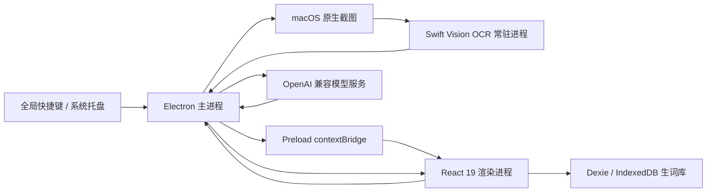

<div align="center">

# Xenon

**专为开发者与深度阅读者打造的桌面双语精读工作站**

截图翻译只是入口。Xenon 把任意屏幕上的英文内容，变成可对照、可拆解、可收藏、可复习的双语阅读材料。

[](https://www.apple.com/macos/)
[](https://react.dev/)
[](https://www.electronjs.org/)
[](https://github.com/GTTaaa/Xenon#支持的模型服务)
[](LICENSE)

</div>

<p align="center">
  
</p>

## 为什么是 Xenon

普通截图翻译工具解决的是「这一段写了什么」。<br />
Xenon 还想继续回答三个问题：

- **这句话为什么这样组织？**
- **这个词为什么在这个语境里取这个意思？**
- **下次再遇到它，我还能不能想起来？**

因此，Xenon 不是浏览器插件的桌面替代品，也不是只负责输出译文的翻译框，而是一套围绕真实英文材料搭建的精读工作流。

### 三项核心能力

#### 01 · 纯本地 macOS Swift Vision OCR

- 截图由 macOS 原生 `screencapture` 获取，文字识别由 Swift 调用 Vision 框架完成。
- 图片停留在本机临时目录，OCR 后立即删除，不经过第三方 OCR 云服务。
- 常驻 OCR 子进程会提前预热模型，已预热后的识别通常在约 0.15 秒量级完成。
- 首次运行 Vision 模型可能需要 30～60 秒初始化，界面会明确显示识别状态，而不是让用户误以为应用卡死。

#### 02 · 句级对齐与整句语法结构透视

- 译文完成后，Xenon 会额外执行一次句级对齐，让原文和译文按语义片段对应。
- 悬停或点击任意一侧，另一侧同步高亮并滚动定位。
- 点击英文句子，可展开「整句结构」：用语义块拆出描述主体、核心动作、动作对象、补充说明和标点，不强行套用主谓宾。
- 对时态、助动词、介词、连词和语序选择，提供简短的中文解释与易混淆写法对比。

这不是语法树或逐词词性标注，而是一种更适合窄窗口快速阅读的「语义角色切块」。

#### 03 · 语境点词、偶遇累积与本地复习

- 学习模式下可直接点击英文单词，查询它在当前句子中的含义，而不是只给词典义。
- 词义卡会区分实义词与语法词，并提供原形、字面义、语境依据、语序作用及对应中文片段。
- 单词可收藏到本地生词库，并保留真实双语语境。
- 已收录的词在后续文本中再次出现时，会自动累计「偶遇次数」。
- 「复习」视图会从本地生词库抽取闪卡，以遮挡释义、悬停揭示、手动翻页的方式强化记忆。

### 与其他工具的差异

| 维度         | 传统翻译工具                   | 浏览器翻译插件           | Xenon                                          |
| ------------ | ------------------------------ | ------------------------ | ---------------------------------------------- |
| 使用边界     | 通常以文本输入或应用内翻译为主 | 主要处理网页内容         | 面向任意桌面应用、PDF、IDE、终端与视频画面     |
| 截图图片隐私 | 部分工具依赖云端 OCR           | 通常不涉及桌面截图       | macOS Vision 本地 OCR，图片不上传              |
| 输出结果     | 以最终译文为主                 | 以网页替换或悬浮译文为主 | 译文、句级对齐、语义结构、语境词义分层呈现     |
| 长难句理解   | 多依赖用户自行分析             | 一般只提供翻译           | 可拆解语义块，并解释关键语法选择               |
| 单词查询     | 常见固定词典义                 | 往往绑定页面或划词能力   | 结合当前双语语境生成释义与语序说明             |
| 词汇沉淀     | 多数工具不负责复习             | 通常缺少本地学习库       | 生词、真实语境、偶遇次数和闪卡复习形成闭环     |
| 模型选择     | 通常由产品固定                 | 通常由产品固定           | 用户自带 API Key，可配置多个 OpenAI 兼容服务商 |
| 数据归属     | 取决于平台                     | 取决于平台               | 配置与生词库保存在本机，无 Xenon 账户体系      |

## 工作流一瞥

1. 在任意应用中按下 `⌥ + S`，框选屏幕区域。
2. 本地 OCR 提取文字，译文以流式方式回到 Xenon 主窗口。
3. 切换到「学习」，查看原文与译文的句级对应。
4. 点击一句英文，展开整句结构与语法选择说明。
5. 点击任意英文词，查看当前语境下的释义并收藏。
6. 在「复习」中重新遇到这些词，完成从阅读到记忆的闭环。

## 快捷键与交互

| 操作           | 默认快捷键        | 说明                                    |
| -------------- | ----------------- | --------------------------------------- |
| 截图翻译       | `⌥ + S`           | 调用 macOS 原生区域截图，OCR 后自动翻译 |
| 唤醒输入翻译   | `⌥ + A`           | 显示主窗口，聚焦并选中输入框            |
| 打开偏好设置   | `⌘ + ,`           | 配置服务商、模型、快捷键与系统行为      |
| 关闭菜单或浮层 | `Esc`             | 依次关闭当前浮层                        |
| 切换复习闪卡   | `←` / `→`         | 在复习视图中切换上一张与下一张          |
| 揭示闪卡释义   | `Enter` / `Space` | 固定或取消固定当前闪卡答案              |

所有全局快捷键都可以在「偏好设置 → 快捷键」中修改。

> 截图 OCR 目前仅支持 macOS。Windows 与 Linux 构建保留文本翻译与学习能力，但不显示截图翻译入口。

## 安装

### 系统要求

- macOS 12 Monterey 或更高版本。
- 截图 OCR 需要授予「屏幕录制」权限。
- 从源码运行需要 Node.js 22 及以上版本与 pnpm。

### 从 Release 安装

1. 从 [GitHub Releases](https://github.com/GTTaaa/Xenon/releases) 下载最新 `.dmg`。
2. 打开镜像，将 `Xenon.app` 拖入 `/Applications`。
3. 启动 Xenon。

当前构建如果尚未完成 Apple Developer ID 签名与公证，macOS 可能会提示应用已损坏、无法验证开发者或被 Gatekeeper 拦截。确认安装包来源可信后，可移除隔离属性：

```bash
xattr -cr /Applications/Xenon.app
open /Applications/Xenon.app
```

> 该命令会移除 macOS 为下载文件添加的隔离标记。请只对来源可信、校验无误的安装包使用。

### 授予屏幕录制权限

首次截图时，Xenon 会请求屏幕录制权限：

1. 打开「系统设置 → 隐私与安全性 → 屏幕录制」。
2. 启用 `Xenon`。
3. 完全退出并重新打开 Xenon。

如果在开发环境中从终端或编辑器启动，macOS 可能要求为 Terminal、iTerm 或 VS Code 授予权限，而不是直接授权给 Electron 应用。

## 初次使用

1. 按 `⌘ + ,` 打开偏好设置。
2. 选择一个内置服务商，或添加任意 OpenAI 兼容服务。
3. 填写该服务商的 Base URL、API Key 和模型 ID。
4. 点击「测试」检查鉴权、首 token 延迟与输出速度。
5. 回到主窗口，按 `⌥ + S` 截图，或按 `⌥ + A` 直接输入文本。
6. 完成翻译后切换到「学习」，开始句级对照、语法透视和点词查询。

Xenon 不内置 Token 额度，也不代收模型费用。所有模型请求均由用户自己的 API Key 直接发起。

### 支持的模型服务

| 服务商        | 默认模型                         | 接入方式    |
| ------------- | -------------------------------- | ----------- |
| DeepSeek 官方 | `deepseek-chat`                  | OpenAI 兼容 |
| ClinePass     | `cline-pass/deepseek-v4.1-flash` | OpenAI 兼容 |
| 通义千问      | `qwen-plus`                      | OpenAI 兼容 |
| OpenAI 官方   | `gpt-4o-mini`                    | OpenAI 兼容 |
| Ollama 本地   | `llama3:latest`                  | OpenAI 兼容 |
| 阶跃星辰      | `step-1-8k`                      | OpenAI 兼容 |
| 自定义服务    | 用户填写                         | OpenAI 兼容 |

当前翻译、对齐、语法透视与点词查询共用主界面选中的服务商与模型。接入本地 OpenAI 兼容服务时，仍需填写该服务接受的非空 API Key，部分本地服务可使用占位值。

## 语言能力

| 能力         | 当前范围                                                               |
| ------------ | ---------------------------------------------------------------------- |
| 界面语言     | 简体中文                                                               |
| 文本语言检测 | 中文、英语、日语、韩语、法语、德语、西班牙语、俄语、意大利语、葡萄牙语 |
| 自动目标语言 | 中文默认译为英语，其他语言默认译为中文                                 |
| 截图 OCR     | 简体中文、英语、日语、韩语                                             |
| 精读学习模式 | 仅英语与简体中文互译                                                   |
| 生词与闪卡   | 英文词汇及其真实双语语境                                               |

## 隐私与数据边界

- 截图图片只在本机进行 OCR，临时文件在识别完成后删除。
- 只有 OCR 提取出的文字、译文及用户主动查询的上下文会发送到所选模型服务。
- Xenon 没有自建账户系统、遥测服务或内置 Token 代理。
- 界面偏好保存在本地 `localStorage`，生词与语境保存在 IndexedDB。
- API Key 与服务商配置保存在本机用户数据目录中的 `llm-config.json`。
- 当前配置文件不是系统钥匙串加密存储，请妥善保护本机用户目录与设备访问权限。

## 技术架构



| 层级     | 技术                                                    |
| -------- | ------------------------------------------------------- |
| 桌面壳层 | Electron 39 + electron-vite                             |
| 界面     | React 19 + TypeScript + 原生 CSS                        |
| 状态管理 | React Hooks、组件状态、`localStorage`、IndexedDB        |
| 原生 OCR | Swift + macOS Vision + 常驻 stdin/stdout 子进程         |
| 模型接入 | OpenAI 兼容 Chat Completions、SSE 流式响应              |
| 本地数据 | Dexie 4 + IndexedDB；配置由主进程写入 JSON              |
| 打包     | electron-builder，支持 macOS、Windows 与 Linux 构建目标 |
| 测试     | Node.js 原生测试框架 + fake-indexeddb                   |

### 目录结构

```text
src/
├── main/
│   ├── index.ts                 # 窗口、托盘、快捷键与 IPC
│   ├── native/mac-ocr/          # Swift Vision OCR
│   └── services/                # 截图、OCR、翻译、对齐、语法与词义服务
├── preload/                     # 受限的渲染进程 API
├── renderer/src/
│   ├── App.tsx                  # 主阅读、学习与复习界面
│   ├── ConfigPage.tsx           # 偏好设置
│   ├── services/                # 生词库与匹配逻辑
│   └── assets/                  # 样式、品牌与插画资源
└── shared/                      # 共享类型、提示词与纯函数
```

### 请求链路

```text
快捷键
  → 隐藏 Xenon 窗口
  → macOS 区域截图
  → Vision OCR
  → 文本回填与流式翻译
  → 句级二次对齐
  → 按需请求语法透视或语境词义
  → 写入本地生词库
```

翻译结果不会被后续对齐请求改写。对齐、语法和点词属于独立增量能力，失败时只关闭对应增强视图，不影响主译文。

## 本地开发

### 环境准备

- macOS 12 及以上。
- Node.js 22 及以上。
- pnpm。
- 编译原生 OCR 时需要 Xcode Command Line Tools。

```bash
pnpm install
pnpm build:ocr
pnpm dev
```

`pnpm install` 会执行 `electron-builder install-app-deps`。如果 `resources/bin/mac-vision-ocr` 已经存在，可跳过 `pnpm build:ocr`。

### 常用命令

```bash
pnpm dev          # 启动主进程与渲染进程开发环境
pnpm lint         # ESLint
pnpm typecheck    # 主进程与渲染进程类型检查
pnpm test         # 单元测试
pnpm format       # Prettier 格式化
pnpm build        # 类型检查并构建应用
pnpm build:mac    # 构建 macOS 安装包
pnpm build:win    # 构建 Windows 安装包
pnpm build:linux  # 构建 Linux 安装包
```

截图与 OCR 链路排障时可开启诊断日志：

```bash
DEBUG_CAPTURE=1 pnpm dev
```

## 已知边界

- 截图 OCR 仅支持 macOS。
- Vision OCR 当前配置为简体中文、英语、日语和韩语。
- 精读、语法透视和生词复习仅面向英语与简体中文互译。
- 语法透视是语义角色切块，不是完整句法树或逐词词性标注。
- 复杂表格、多栏排版和跨行断词不会被完整还原；排版保留主要依赖 OCR 行结果与模型提示词约束。
- 闪卡复习是随机抽取与偶遇计数，不等同于基于遗忘曲线的间隔重复系统。
- 翻译、对齐、语法和词义能力都依赖用户配置的外部模型服务。

## 参与贡献

欢迎提交 Issue 与 Pull Request。

提交前请至少运行：

```bash
pnpm lint
pnpm typecheck
pnpm test
```

涉及界面改动时，请附上截图或录屏；涉及模型行为改动时，请说明所用服务商、模型与示例文本。不要在 Issue、日志或提交中包含真实 API Key。

## 许可证

本项目采用 [MIT License](LICENSE)。

## 第三方资产鸣谢

- [Open Peeps](https://www.openpeeps.com/)：偶遇复习卡片中的人物插画来源。项目从本地精灵表截取人物帧并绘制为 Canvas 动画。
- [Skiper UI Canvas crowd](https://skiper-ui.com/v1/skiper39)：人群动画的实现思路参考。当前实现已改为不依赖第三方动画库的原生 Canvas 版本，并按免费版本授权要求保留署名。

更多信息见 [THIRD_PARTY_NOTICES.md](THIRD_PARTY_NOTICES.md)。

---

<div align="center">

**Xenon** · 把屏幕变成可解释、可积累的双语书页

</div>
