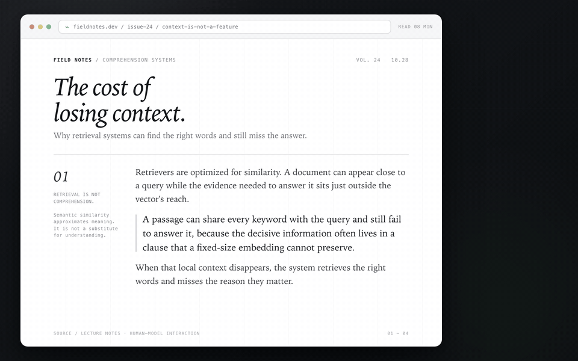
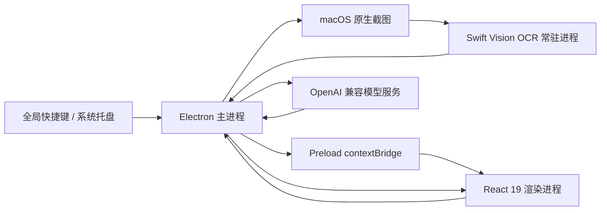

<div align="center">

# Xenon

**截图即译，保留上下文的桌面翻译器**

本机 OCR、流式译文与多模型 BYOK，让屏幕上的任何文字都能立刻读懂。

[](https://www.apple.com/macos/)
[](https://react.dev/)
[](https://www.electronjs.org/)
[](https://github.com/GTTaaa/Xenon#支持的模型服务)
[](LICENSE)

</div>

<p align="center">
  
</p>

## 为什么是 Xenon

浏览器插件只覆盖网页，传统翻译器通常要求你把文字复制出来。Xenon 面向真正发生在桌面上的阅读：PDF、IDE、终端、设计稿、视频画面，以及那些无法被浏览器插件触及的文字。

按下 `⌥ + S` 框选屏幕区域，图片留在本机完成 OCR，识别文本随后以流式译文返回一个始终贴靠屏幕右上角的窄窗。没有账户体系，没有内置 Token 额度，也不把截图上传到第三方 OCR 服务。

### 核心能力

#### 01 · macOS Swift Vision 本地 OCR

- 截图由 macOS 原生 `screencapture` 获取，文字识别由 Swift 调用 Vision 框架完成。
- 图片只写入本机临时目录，识别结束后立即删除，不经过云端 OCR。
- 常驻 OCR 子进程会在应用启动后预热，减少首次截图之外的模型初始化开销。
- 首次运行 Vision 模型可能需要 30～60 秒初始化，界面会明确显示识别状态。
- 保留 Vision 返回的行结构，再交给模型按原有段落与换行翻译，减少技术文档被重新排版的问题。

#### 02 · 流式译文与稳定的阅读节奏

- 模型输出 token 后即时上屏，不需要等待整段译完。
- 高频增量按动画帧合并渲染，持续输出时仍保持界面流畅。
- 默认提示词要求保留原始换行、列表、标题、URL、日期与分隔符的位置。
- 支持自动复制译文，也保留显式复制按钮与完成状态反馈。
- 可在已启用的渠道与模型之间即时切换；切换后会重新翻译当前文本。

#### 03 · 358px 纸白窄窗，常驻但不打扰

- 默认以 358px 紧凑宽度贴靠屏幕工作区右上角。
- 窗口高度随输入与译文内容自适应，长文本在译文区内部滚动。
- 支持一键置顶、系统托盘常驻与关闭后隐藏。
- 现代纸白配色、清晰字阶与浅绿色状态反馈，保持克制、接近实体杂志的阅读质感。

#### 04 · BYOK 与多服务商路由

- 支持任意 OpenAI Chat Completions 兼容接口。
- 每个渠道独立保存 Base URL、API Key 与模型列表，可单独启用或停用。
- 内置连通性测试，展示请求延迟、首 token 延迟与输出速度。
- Xenon 不代收模型费用。请求由用户自己的 API Key 直接发往所选服务商。

### 与其他工具的差异

| 维度         | 传统翻译工具                 | 浏览器翻译插件         | Xenon                                      |
| ------------ | ---------------------------- | ---------------------- | ------------------------------------------ |
| 使用边界     | 通常依赖复制粘贴或应用内输入 | 主要处理网页内容       | 面向任意桌面应用、PDF、IDE、终端与视频画面 |
| 截图图片隐私 | 部分工具依赖云端 OCR         | 通常不涉及桌面截图     | macOS Vision 本地 OCR，图片不上传          |
| 输出方式     | 多以最终译文为主             | 多为网页替换或悬浮译文 | 窄窗流式输出，保留原始段落结构             |
| 模型选择     | 通常由产品固定               | 通常由产品固定         | 用户自带 API Key，可配置多个兼容服务商     |
| 数据归属     | 取决于平台                   | 取决于平台             | 配置保存在本机，无 Xenon 账户、遥测或代理  |
| 常驻体验     | 需要切换窗口或反复粘贴       | 依附浏览器页面         | 托盘常驻，快捷键瞬时呼出，一键置顶         |

## 工作流一瞥

1. 在任意应用中按下 `⌥ + S`。
2. 用 macOS 原生矩形选区框住需要翻译的内容。
3. Xenon 隐藏自身窗口，完成截图后恢复并显示本地 OCR 进度。
4. Vision 提取文字，输入框自动回填，译文开始流式输出。
5. 阅读、复制译文，或按 `⌥ + A` 继续输入下一段文字。

## 快捷键与交互

| 操作         | 默认快捷键 | 说明                                    |
| ------------ | ---------- | --------------------------------------- |
| 截图翻译     | `⌥ + S`    | 调用 macOS 原生区域截图，OCR 后自动翻译 |
| 输入翻译     | `⌥ + A`    | 显示主窗口，聚焦并选中输入框            |
| 打开偏好设置 | `⌘ + ,`    | 配置服务商、模型、快捷键与系统行为      |
| 关闭浮层     | `Esc`      | 关闭语言菜单或模型面板                  |

所有全局快捷键都可以在「偏好设置 → 快捷键」中修改。

> 截图 OCR 目前仅支持 macOS。Windows 与 Linux 构建保留文本输入翻译能力，但不显示截图入口。

## 安装

### 系统要求

- macOS 12 Monterey 或更高版本。
- 截图 OCR 需要授予「屏幕录制」权限。
- 从源码运行需要 Node.js 22 及以上版本与 pnpm。

### 从 Release 安装

1. 从 [GitHub Releases](https://github.com/GTTaaa/Xenon/releases) 下载最新 `.dmg`。
2. 打开镜像，将 `Xenon.app` 拖入 `/Applications`。
3. 启动 Xenon。

当前构建尚未完成 Apple Developer ID 签名与公证时，macOS 可能提示应用已损坏、无法验证开发者或被 Gatekeeper 拦截。确认安装包来源可信后，可移除隔离属性：

```bash
xattr -cr /Applications/Xenon.app
open /Applications/Xenon.app
```

> 该命令会移除 macOS 为下载文件添加的隔离标记。请只对来源可信、校验无误的安装包使用。

### 授予屏幕录制权限

首次截图时，Xenon 会请求屏幕录制权限：

1. 打开「系统设置 → 隐私与安全性 → 屏幕录制」。
2. 启用 `Xenon`。
3. 完全退出并重新打开 Xenon。

如果在开发环境中从终端或编辑器启动，macOS 可能要求为 Terminal、iTerm 或 VS Code 授予权限，而不是直接授权给 Electron 应用。

## 初次使用

1. 按 `⌘ + ,` 打开偏好设置。
2. 选择一个内置服务商，或添加任意 OpenAI 兼容服务。
3. 填写该服务商的 Base URL、API Key 和模型 ID。
4. 点击「测试」检查鉴权、首 token 延迟与输出速度。
5. 回到主窗口，按 `⌥ + S` 截图，或按 `⌥ + A` 直接输入文本。
6. 完成翻译后点击右下角按钮复制结果。

Xenon 不内置 Token 额度，也不代收模型费用。所有模型请求均由用户自己的 API Key 直接发起。

### 支持的模型服务

| 服务商        | 默认模型                         | 接入方式    |
| ------------- | -------------------------------- | ----------- |
| DeepSeek 官方 | `deepseek-chat`                  | OpenAI 兼容 |
| ClinePass     | `cline-pass/deepseek-v4.1-flash` | OpenAI 兼容 |
| 通义千问      | `qwen-plus`                      | OpenAI 兼容 |
| OpenAI 官方   | `gpt-4o-mini`                    | OpenAI 兼容 |
| Ollama 本地   | `llama3:latest`                  | OpenAI 兼容 |
| 阶跃星辰      | `step-1-8k`                      | OpenAI 兼容 |
| 自定义服务    | 用户填写                         | OpenAI 兼容 |

接入本地 OpenAI 兼容服务时，仍需填写该服务接受的非空 API Key，部分本地服务可使用占位值。

## 语言能力

| 能力         | 当前范围                                                               |
| ------------ | ---------------------------------------------------------------------- |
| 界面语言     | 简体中文、English                                                      |
| 文本语言检测 | 中文、英语、日语、韩语、法语、德语、西班牙语、俄语、意大利语、葡萄牙语 |
| 自动目标语言 | 中文默认译为英语，其他语言默认译为中文                                 |
| 截图 OCR     | 简体中文、英语、日语、韩语                                             |

## 隐私与数据边界

- 截图图片只在本机进行 OCR，临时文件在识别完成后删除。
- 只有 OCR 提取出的文字会发送到用户选择的模型服务。
- Xenon 没有自建账户系统、遥测服务或内置 Token 代理。
- 界面语言会缓存到本地 `localStorage`，并随通用设置写入 `llm-config.json`。
- API Key 与服务商配置保存在本机用户数据目录中的 `llm-config.json`。
- 当前配置文件不是系统钥匙串加密存储，请妥善保护本机用户目录与设备访问权限。

## 技术架构



| 层级     | 技术                                                    |
| -------- | ------------------------------------------------------- |
| 桌面壳层 | Electron 39 + electron-vite                             |
| 界面     | React 19 + TypeScript + 原生 CSS（现代纸白单栏排版）    |
| 状态管理 | React Hooks、组件状态与 `localStorage`                  |
| 原生 OCR | Swift + macOS Vision + 常驻 stdin/stdout 子进程         |
| 模型接入 | OpenAI 兼容 Chat Completions、SSE 流式响应              |
| 本地配置 | 主进程读写用户数据目录中的 JSON                         |
| 打包     | electron-builder，支持 macOS、Windows 与 Linux 构建目标 |
| 测试     | Node.js 原生测试框架                                    |

### 目录结构

```text
src/
├── main/
│   ├── index.ts                 # 窗口、托盘、快捷键与 IPC
│   ├── native/mac-ocr/          # Swift Vision OCR
│   └── services/                # 截图、OCR、翻译与配置服务
├── preload/                     # 受限的渲染进程 API
├── renderer/src/
│   ├── App.tsx                  # 截图翻译主界面
│   ├── ConfigPage.tsx           # 偏好设置
│   └── assets/                  # 样式与品牌资源
└── shared/                      # 共享类型、语言检测与流式解析
```

### 请求链路

```text
快捷键
  → 隐藏 Xenon 窗口
  → macOS 区域截图
  → Vision 本地 OCR
  → 文本回填
  → OpenAI 兼容模型流式翻译
  → 译文增量渲染
  → 可复制结果
```

## 本地开发

### 环境准备

- macOS 12 及以上。
- Node.js 22 及以上。
- pnpm。
- 编译原生 OCR 时需要 Xcode Command Line Tools。

```bash
pnpm install
pnpm build:ocr
pnpm dev
```

`pnpm install` 会执行 `electron-builder install-app-deps`。如果 `resources/bin/mac-vision-ocr` 已经存在，可跳过 `pnpm build:ocr`。

### 常用命令

```bash
pnpm dev          # 启动主进程与渲染进程开发环境
pnpm lint         # ESLint
pnpm typecheck    # 主进程与渲染进程类型检查
pnpm test         # 单元测试
pnpm format       # Prettier 格式化
pnpm build        # 类型检查并构建应用
pnpm build:mac    # 构建 macOS 安装包
pnpm build:win    # 构建 Windows 安装包
pnpm build:linux  # 构建 Linux 安装包
```

截图与 OCR 链路排障时可开启诊断日志：

```bash
DEBUG_CAPTURE=1 pnpm dev
```

### 分支说明

- `main`：面向公开版本的纯截图翻译形态。
- `studio`：个人精读实验分支，保留句级对齐、语法透视、语境点词与复习等额外能力，不属于公开版功能承诺。

## 已知边界

- 截图 OCR 仅支持 macOS。
- Vision OCR 当前配置为简体中文、英语、日语和韩语。
- 首次启用 Vision 模型时可能需要 30～60 秒初始化。
- 复杂表格、多栏排版和跨行断词不会被完整还原；排版保留主要依赖 OCR 行结果与模型提示词约束。
- 翻译能力依赖用户配置的外部模型服务，译文质量与响应速度由所选服务商和模型决定。

## 参与贡献

欢迎提交 Issue 与 Pull Request。

提交前请至少运行：

```bash
pnpm lint
pnpm typecheck
pnpm test
```

涉及界面改动时，请附上截图或录屏；涉及模型行为改动时，请说明所用服务商、模型与示例文本。不要在 Issue、日志或提交中包含真实 API Key。

## 许可证

本项目采用 [MIT License](LICENSE)。

---

<div align="center">

**Xenon** · 让屏幕上的每段文字，都触手可及

</div>
